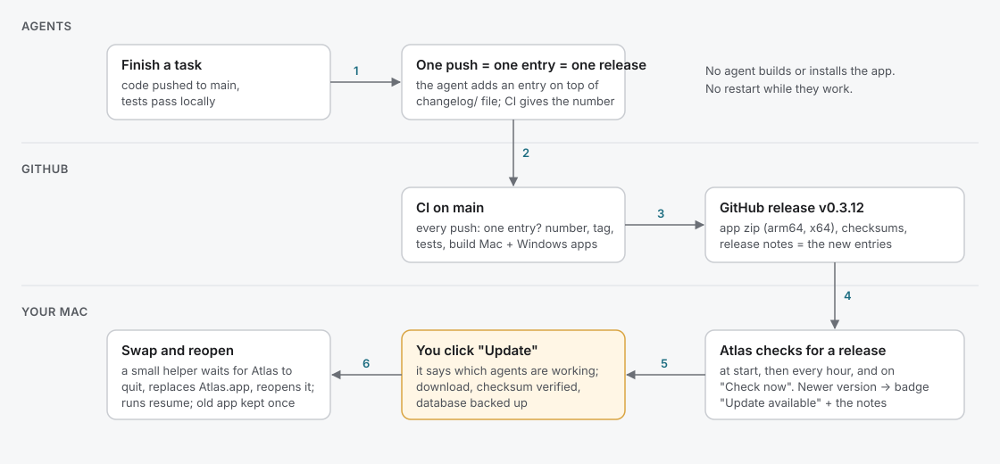

# App updates from GitHub releases

Status: design approved by Master (18 Nov 2026). Build: see the tasks at the end.

## Why

Since v3, every finished task rebuilt and reinstalled the app. In two hours that restarted Atlas 13 times and
interrupted 59 agent runs; about 40% of all tool time was agents waiting. With an updater, agents only push code, and
the app restarts once, when Master clicks.

## How it works

1. **One push to main = one changelog entry = one release** (Master, 18 Nov 2026). Whoever pushes to main (an agent
   finishing a task, a merged pull request, a small direct fix) adds exactly one entry at the top of `CHANGELOG.md`,
   in plain words, headed by its kind and the task when there is one (`## Changed · #102 · The chat box grows with your text`). No agent
   runs `install:mac` any more. Work in progress goes to a branch, not to main.
2. **Versions follow Semantic Versioning** (semver.org: MAJOR.MINOR.PATCH), and the changelog follows Keep a
   Changelog (keepachangelog.com). Each entry says what kind of change it is, and that decides the number:
   `Fixed` raises PATCH (0.3.1 → 0.3.2); `Added` or `Changed` raises MINOR (0.3.2 → 0.4.0); `Breaking` (existing data
   or settings stop working without action) raises MAJOR. Atlas starts at 0.3.0, as SemVer allows for software still
   below 1.0. Agents write the kind, not the number: CI computes the number by reading the changelog from the oldest
   entry to the newest, so the same file always gives the same version and two pushes can't get the same one.
3. **CI releases every push.** On each push to main: check that it adds exactly one changelog entry (the check
   fails otherwise, and says so on the task), run the tests, build the apps, publish a GitHub release whose notes
   are that entry. Each push gets its own release; builds of two pushes can run side by side. If the tests fail,
   there is no release for that push, and the task is reopened with the error.
4. **The app checks.** At start, every hour, and on "Check now" in Settings → About. It asks GitHub for the latest
   release (the repo is public, so no token) and compares versions.
5. **Master updates.** A badge "Update available" in the sidebar; clicking it shows the notes of every version
   between the installed one and the latest, and an "Update" button. Versions can be skipped: updating always goes
   straight to the latest.
   If agents are working, it says which ones and that they resume afterwards.
6. **Swap.** The app downloads the zip for this Mac's chip, checks its SHA-256 against the release's checksum file,
   backs up the database, then starts a small helper that waits for Atlas to quit, replaces `/Applications/Atlas.app`
   and reopens it. The replacement is one atomic swap (`renamex_np` with `RENAME_SWAP`, #161), so the helper can be
   killed at any point and an app still opens (old or new); on another volume it falls back to two renames, with a
   short window where no Atlas.app exists. The previous app is kept once (`Atlas.previous.app` in the data folder).

## Decisions

| Point | Choice | Why |
|---|---|---|
| Updater | Our own, unsigned | Electron's built-in one needs an Apple Developer account. Ours does what `install:mac` does today, minus the build. |
| What is a release | Every push to main, with its one changelog entry (Master, 18 Nov 2026) | A release no longer restarts anything, so it costs the agents nothing; main, the changelog and the releases always say the same thing. |
| Version numbers | Semantic Versioning, computed by CI from each entry's kind | It is the common standard; agents working in parallel would pick the same number if they typed it. |
| When it installs | Only on Master's click (confirmed 18 Nov 2026) | A restart interrupts running agents; Master picks the moment. |
| Download format | zip of the .app, added next to the dmg | A dmg has to be mounted; a zip is unpacked with `ditto`. |
| Windows | Release is built, no in-app update yet | Nobody runs Atlas on Windows today. |

## What changes

- **`CHANGELOG.md`** (new), one entry per task, newest on top, with the tasks since v3 as the first entries.
- **CI** (`.github/workflows/ci.yml`): a release job as in steps 2–3; a zip target and a checksum file for the Mac build.
- **Engine / desktop:** an update module (check, download, verify, hand over to the helper), state in SQLite
  (last check, available version, download progress) so a kill at any moment leaves the installed app intact.
- **UI:** the badge, the notes dialog, a line in Settings → About (current version, last check, "Check now").
- **`CLAUDE.md`:** the "after every change that ships: install" rule is replaced by "push, add a changelog line,
  never install". Agents test UI work against a local build (`ui-check --ui packages/ui/dist`); engine work with the
  tests and, when needed, a second engine on a copy of the database.
- **`install:mac`** stays for a build from source by hand.

## Risks and limits

- **Unsigned means trust rests on the GitHub repo.** Anyone who can push to main can ship code to this Mac. That is
  already true today (agents build main and install it). The checksum only protects against a broken download.
- **Database migrations go forward only.** Going back to the previous app after a migration ran needs the database
  backup taken in step 6; the dialog for "restore previous version" says so. Not in the first version unless asked.
- **Delay.** A version appears when CI has built it. Not measured yet; to be reported by the build task.
- **Many versions.** Last night that would have been about 10 versions in two hours. The badge only says that an
  update exists, it does not ask again for each one.
- **A task is "done" before its release exists.** The agent's report says "pushed, release building"; if CI fails,
  the task is reopened with the error.
- **To verify while building:** that a CI-built unsigned app opens on Apple silicon without a Gatekeeper prompt when
  the app itself downloaded it (no quarantine flag), as the locally built one does today.

## Tasks, once approved

1. munih: changelog, CI release job, updater module, UI. Done when a real release made from main updates the installed app with one click.
2. zurich: test it: kill during download and during the swap, bad checksum, no network, update while agents run.
3. atlas: change `CLAUDE.md` and the task briefs.

**Integrity, not authenticity.** SHA256SUMS.txt is published in the same release as the zip, so the checksum catches a broken or truncated download, not a tampered release. Without code signing (Master chose the unsigned route) trust rests on the GitHub repository itself.
